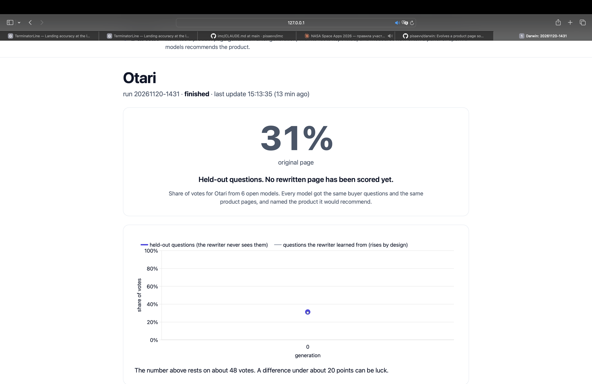

# Darwin — evolve your page until AI recommends it

More and more buyers ask an AI assistant *"which tool should I use for X?"* instead of searching themselves. If the AI doesn't recommend your product, you lose the customer — and today there is no simple way to measure that, let alone improve it.

**Darwin measures how often AI models recommend your product, then evolves your product page, generation after generation, so that more models pick it — without inventing a single fact.**



## How it works

1. **Research (once).** Darwin searches the web (Tavily, through Otari) for your category, finds the competitors buyers are offered, and reads their real product pages. It also builds a fact sheet about your product from your own pages.
2. **Measure.** A panel of 6 open models from 6 different makers gets a buyer's question and six product pages (yours and 5 competitors', shuffled, unlabelled) and recommends one. The share of votes your page wins is the score.
3. **Evolve.** A strong model rewrites the best pages into new variants, using the reasons the panel gave for picking competitors.
4. **Keep it honest.** Every rewrite is checked twice — in code (no number that isn't in the fact sheet, no competitor names, no sentences aimed at AI models) and by a separate checker model. Rewrites that break the facts are dropped.
5. **Prove it.** The evolution only ever sees *training* questions. The result is reported on *held-out* questions it never saw, so the gain isn't just learning what the panel likes.

The run stops when the generations are done — or when **Otari's budget cap** stops it.

## First result

For **Otari** (Mozilla's open-source AI gateway) against LiteLLM, Portkey, Kong AI Gateway, Cloudflare AI Gateway and Bifrost:

| | Share of votes (held-out questions) |
|---|---|
| Otari's page today | **31%** |
| LiteLLM | about 60% |

Measured twice; 79 of 84 picks were identical between the two runs.

## Built on Otari

Every model call, web search and page fetch goes through [Otari](https://otari.ai), self-hosted on a Nebius VM, with models from **Nebius Token Factory**.

| Otari feature | Its job in Darwin |
|---|---|
| One OpenAI-compatible endpoint | Every call to every model goes through it |
| Nebius as provider, pinned model names (`nebius:…`) | The panel is exactly the models we chose — no silent swaps |
| Model list and built-in price list | Start-up test: is each model there and priced? |
| Cost in every answer | Running cost per vote and per generation |
| API keys with their own budget | The hard cap that stops a run |
| Key budget view | The budget bar, and "is there enough left for one more generation?" |
| Budget refusal (`budget_exceeded`) | The hard stop |
| Search tool (Tavily) | Finding the competitors |
| Built-in fetch | Reading competitor pages and ours |
| Prices for search and fetch | Research counts against the same cap |
| Request tags | Where the money went: panel, rewriter, checker, research |
| Sessions | Each run is one session in the Otari dashboard |

## Run it

```bash
python3 -m venv .venv && .venv/bin/python -m pip install -r requirements.txt
# .env: OTARI_BASE_URL, OTARI_MASTER_KEY, NEBIUS_API_KEY, TAVILY_API_KEY
.venv/bin/python setup_gateway.py init        # adds Tavily to Otari
.venv/bin/python setup_gateway.py key dev 3   # a key capped at $3
.venv/bin/python check.py                     # gateway, key, models, search, fetch
.venv/bin/python research.py                  # competitors, our page, facts -> data/
.venv/bin/python evolve.py                    # measure and evolve
.venv/bin/python web/serve.py                 # chart page at http://127.0.0.1:8010
```

## What's next

The same engine works for any go-to-market text: a pitch, a cold email, a landing page. Next step: a platform where a team pastes its text and gets back the version that most models prefer — with the facts unchanged.

## Honest limits

- The panel is open models handed these pages, not ChatGPT or Perplexity choosing their own sources.
- With about 48 votes per score, a difference under about 20 points can be luck; the final check uses more votes.
